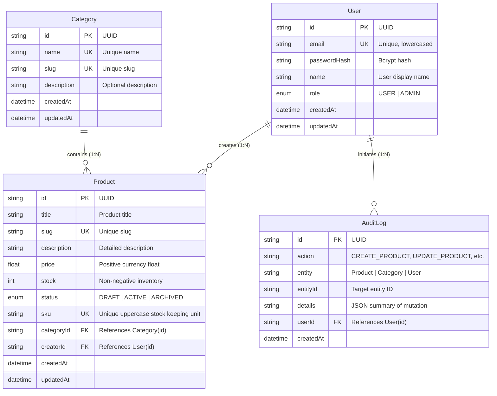

# Secured RESTful CRUD API Server with Relational SQL Database

A production-grade, scalable backend RESTful API server built using **Node.js**, **Express**, **TypeScript**, and **Prisma ORM** with an active connection to an SQL relational database (SQLite / PostgreSQL).

---

## 🌟 Key Features & Architecture

- **Modern Server Architecture**: Clean layered modular design (Routes -> Middleware -> Controllers -> Services -> Database/Prisma) with strict TypeScript type safety.
- **Active SQL Relational Database**: Structured data schemas with foreign keys, unique constraints, indices, cascading rules, and atomic transactions.
- **Robust Middleware Validation Layer**: Powered by **Zod**, providing deep schema validation across `req.body`, `req.query`, and `req.params` with structured, actionable 422 error outputs.
- **Enterprise-Grade Security**:
  - **Helmet**: Secures HTTP response headers against clickjacking, MIME-sniffing, XSS, etc.
  - **CORS**: Configurable cross-origin resource sharing policy.
  - **Express Rate Limiting**: Dual-tier rate limiting (strict brute-force limiter for auth; high-throughput limiter for API routes).
  - **JWT Authentication**: Stateless, signed JSON Web Tokens for user authentication.
  - **Role-Based Access Control (RBAC)**: Role checks (`USER` vs `ADMIN`) and resource ownership authorization.
  - **Password Hashing**: Secure bcrypt hashing with 12 salt rounds.
  - **Audit Logging**: Automatic database audit logging on critical data mutations inside atomic transactions.
- **Interactive Documentation**: Embedded **OpenAPI 3.0 (Swagger UI)** at `/api-docs`.
- **Health Check & Ping**: Live database query ping and latency tracking at `/health`.
- **Automated Testing Suite**: 100% test coverage for authentication, authorization, CRUD operations, and middleware validation via **Vitest** and **Supertest** (30 passing tests).

---

## 🏗️ Relational Database Schema



---

## 📂 Project Structure

```
Task_Two/
├── prisma/
│   ├── schema.prisma          # Structured relational database schema
│   └── seed.ts                # Database seeder (Admin, User, Categories, Products)
├── src/
│   ├── config/
│   │   ├── env.ts             # Validated environment configuration with Zod
│   │   └── database.ts        # Prisma client with active connection ping & lifecycle
│   ├── errors/
│   │   └── AppError.ts        # Standardized HTTP error hierarchy (400, 401, 403, 404, 409, 422)
│   ├── middleware/
│   │   ├── auth.ts            # JWT verification & user extraction
│   │   ├── authorize.ts       # Role-Based Access Control (RBAC)
│   │   ├── errorHandler.ts    # Centralized error handler & Prisma error transformer
│   │   ├── rateLimiter.ts     # IP-based rate limiting
│   │   └── validate.ts        # Zod schema validation middleware (body, query, params)
│   ├── modules/
│   │   ├── auth/              # Registration, Login, Profile (/api/v1/auth)
│   │   ├── categories/        # Categories CRUD with pagination (/api/v1/categories)
│   │   ├── health/            # Active SQL database ping & uptime (/health)
│   │   ├── products/          # Products CRUD with filters & transactions (/api/v1/products)
│   │   └── users/             # User management & profile updates (/api/v1/users)
│   ├── docs/
│   │   └── swagger.yaml       # OpenAPI 3.0 API specification
│   ├── types/
│   │   └── auth.ts            # Express request typing extensions
│   ├── app.ts                 # Express application assembly
│   └── server.ts              # Server bootstrap and graceful shutdown handlers
├── tests/
│   ├── auth.test.ts           # Authentication & token tests
│   ├── categories.test.ts     # Category CRUD & Admin RBAC tests
│   ├── products.test.ts       # Product CRUD, relations, and ownership tests
│   └── validation.test.ts     # Zod middleware & error handling tests
├── requests.http              # Ready-to-run REST Client testing script
├── tsconfig.json              # TypeScript configuration
├── vitest.config.ts           # Test runner configuration
├── .env.example               # Environment variables template
├── .env                       # Local environment variables
└── README.md
```

---

## 🚀 Quick Start Guide

### 1. Prerequisites
- **Node.js**: v18.0.0 or higher (v24+ supported)
- **npm**: v9.0.0 or higher

### 2. Environment Configuration
The `.env` file is pre-configured for local SQLite development with zero external dependencies. If you prefer PostgreSQL, update `DATABASE_URL` and `prisma/schema.prisma` datasource provider.

```env
PORT=4000
NODE_ENV=development
DATABASE_URL="file:./dev.db"
JWT_SECRET=super_secret_jwt_access_token_key_change_in_production
JWT_EXPIRES_IN=7d
CORS_ORIGIN=*
RATE_LIMIT_WINDOW_MS=900000
RATE_LIMIT_MAX=100
```

### 3. Initialize & Seed Database
Synchronize the relational schema to the database and populate initial demo records:

```bash
# Push schema to SQL database
npx prisma db push

# Seed initial admin, user, categories, and products
npm run prisma:seed
```

### 4. Run the Development Server
```bash
npm run dev
```

The server will start on `http://localhost:4000`.
- **Interactive Swagger Documentation**: `http://localhost:4000/api-docs`
- **Active SQL Database Health Check**: `http://localhost:4000/health`

### 5. Production Build & Start
```bash
npm run build
npm start
```

---

## 🧪 Running the Test Suite

Run the automated test suite powered by Vitest and Supertest:

```bash
npm test
```

### Test Coverage Highlights:
- **Authentication**: Valid registration, password strength, duplicate email rejection (409), password hashing verification, JWT token issuance, login validation, and profile retrieval.
- **RBAC & Authorization**: Verifies `ADMIN` privilege enforcement on category mutation; verifies resource creator ownership checks on product modification/deletion.
- **Relational Integrity**: Rejects product creation when referenced `categoryId` does not exist (400); prevents category deletion when products are attached.
- **Middleware Validation**: Tests schema rejection on negative numbers, short strings, malformed email/UUID formats, and malformed JSON payloads.

---

## 📡 API Endpoints Reference

### 1. System & Health
| Method | Endpoint | Access | Description |
| :--- | :--- | :--- | :--- |
| `GET` | `/health` | Public | SQL ping (`SELECT 1`), latency, uptime, memory |
| `GET` | `/api-docs` | Public | Interactive Swagger UI API documentation |

### 2. Authentication (`/api/v1/auth`)
| Method | Endpoint | Access | Description |
| :--- | :--- | :--- | :--- |
| `POST` | `/api/v1/auth/register` | Public | Register new user account & return JWT |
| `POST` | `/api/v1/auth/login` | Public | Authenticate user & return JWT token |
| `GET` | `/api/v1/auth/me` | Bearer Token | Get authenticated user profile |

### 3. Categories (`/api/v1/categories`)
| Method | Endpoint | Access | Description |
| :--- | :--- | :--- | :--- |
| `GET` | `/api/v1/categories` | Public | List categories with product count & pagination |
| `GET` | `/api/v1/categories/:id`| Public | Get single category by UUID |
| `POST` | `/api/v1/categories` | Admin Only | Create new category (auto-slug generated) |
| `PUT` | `/api/v1/categories/:id`| Admin Only | Update category name/description |
| `DELETE`| `/api/v1/categories/:id`| Admin Only | Delete category (blocked if products linked) |

### 4. Products CRUD (`/api/v1/products`)
| Method | Endpoint | Access | Description |
| :--- | :--- | :--- | :--- |
| `GET` | `/api/v1/products` | Public | Query products (filtering, search, sorting, pagination) |
| `GET` | `/api/v1/products/:id` | Public | Get product details with Category and Creator |
| `POST` | `/api/v1/products` | Authenticated | Create product (validates FK, creates audit log) |
| `PUT` | `/api/v1/products/:id` | Creator / Admin| Full product update with audit logging |
| `PATCH` | `/api/v1/products/:id` | Creator / Admin| Partial product update with audit logging |
| `DELETE`| `/api/v1/products/:id` | Creator / Admin| Delete product with audit logging |

### 5. User Management (`/api/v1/users`)
| Method | Endpoint | Access | Description |
| :--- | :--- | :--- | :--- |
| `GET` | `/api/v1/users` | Admin Only | List users with pagination |
| `GET` | `/api/v1/users/:id` | Authenticated | Get user profile & recent products |
| `PATCH` | `/api/v1/users/:id` | Self / Admin | Update profile or promote role (Admin only) |

---

## 🔒 Security & Validation Details

### Validation Middleware Example (`Zod`)
```typescript
// Incoming data structure validation
export const createProductSchema = z.object({
  title: z.string().min(2).max(100).trim(),
  price: z.number().positive().max(1000000),
  stock: z.number().int().nonnegative().default(0),
  status: z.enum(['DRAFT', 'ACTIVE', 'ARCHIVED']).default('DRAFT'),
  sku: z.string().min(3).max(30).toUpperCase().trim(),
  categoryId: z.string().uuid(),
});
```

### Standardized Error Format (HTTP 422)
```json
{
  "status": "fail",
  "statusCode": 422,
  "message": "Validation failed on incoming request payload",
  "errors": [
    {
      "field": "price",
      "message": "Price must be greater than zero",
      "rule": "too_small"
    },
    {
      "field": "categoryId",
      "message": "Category ID must be a valid UUID",
      "rule": "invalid_string"
    }
  ]
}
```

---

## 👥 Seeded Default Accounts

| Email | Password | Role | Permissions |
| :--- | :--- | :--- | :--- |
| `admin@example.com` | `AdminPass123!` | `ADMIN` | Full CRUD, Category Management, User Management |
| `user@example.com` | `UserPass123!` | `USER` | Product Create, Read All, Modify/Delete Own |
